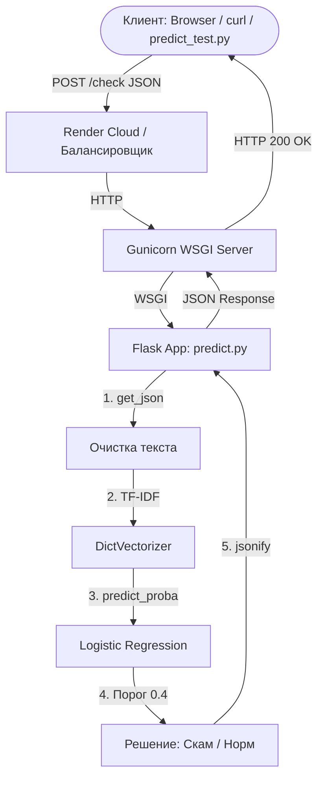

# 📱 Детектор Скам-сообщений и Спама (API)

End-to-end ML-сервис, который определяет, является ли SMS-сообщение мошенническим (скам/спам) или обычным. Проект включает полный цикл: от обучения модели с учетом дисбаланса классов до упаковки в Docker и деплоя в облако.

## 📖 О проекте
Фишинг и мошенничество в SMS — огромная проблема. Пользователи часто получают сообщения вроде *«Ваш аккаунт заблокирован, подтвердите данные»* и теряют деньги. Этот сервис работает как **система триажа**: он классифицирует текст и возвращает вероятность того, что это мошенничество.

**Живое демо (API):** [`https://sms-scam-detector-jj8y.onrender.com/health`]
*(Примечание: Сервис развернут на бесплатном тарифе Render, поэтому первый запрос может занять ~50 секунд для «пробуждения»).*

## 📊 Данные и Бизнес-задача
* **Датасет:** SMS Spam Collection (5 572 сообщения).
* **Проблема:** Сильный **дисбаланс классов**. Только **13.4%** сообщений — это спам (747 из 5572), остальные 86.6% — нормальные.
* **Бизнес-цель:** Для детектора мошенничества **False Negative (пропустить скам) гораздо дороже, чем False Positive (заблокировать обычное СМС)**. Поэтому модель должна максимизировать **Recall**.

## 🧠 Подход к машинному обучению
* **Предобработка текста:** Приведение к нижнему регистру, удаление ссылок и пунктуации. Превращение меток в 0 и 1.
* **Разделение данных:** Разделение данных на train/test/val со стратификацией для spam.
* **Векторизация:** TF-IDF (униграммы и биграммы).
* **Модель:** Логистическая регрессия с `class_weight='balanced'` для компенсации дисбаланса.
* **Настройка порога:** Вместо стандартного `0.5` выбран порог **`0.4`**, чтобы намеренно повысить полноту (Recall).
* **Финальная модель:** Обучение на train+val. Тестирование модели на test и вывод ключевых метрик.

## 📈 Финальные метрики (на тестовой выборке)
* **Recall:** `94.0%` (Мы ловим 94% всех мошеннических сообщений!)
* **Precision:** `85.0%`
* **PR AUC:** `97.0%` (Основная метрика из-за дисбаланса)
* **ROC AUC:** `99.0%`

*Сравнение:* «Глупая» модель, которая всегда говорит «Нормально», имеет Accuracy 86.6%, но **Recall 0%**. Accuracy здесь бесполезен, поэтому были выбраны PR-AUC и Recall.

## 🧪 Примеры работы модели

| Входной текст | Ответ API | Интерпретация |
| :--- | :--- | :--- |
| `"URGENT! You have won a 1 week FREE membership. Call now!"` | `{"is_scam": true, "probability": 0.9936}` | ✅ **Скам** (модель уверена на 99%) |
| `"Hey, are we still meeting for lunch tomorrow?"` | `{"is_scam": false, "probability": 0.0702}` | ✅ **Норм** (модель уверена на 93%) |
| `"Your account has been suspended. Verify your details immediately."` | `{"is_scam": true, "probability": 0.6979}` | ✅ **Скам** (фишинг, порог 0.4 сработал) |
| `"Can you send me the report by 5pm?"` | `{"is_scam": false, "probability": 0.1285}` | ✅ **Норм** (рабочее СМС) |

## 🛠 Технологии
* **Язык:** Python 3.11
* **ML-библиотеки:** Scikit-learn, Pandas, NumPy
* **Веб-фреймворк:** Flask
* **WSGI-сервер:** Gunicorn (для продакшена)
* **Контейнеризация:** Docker
* **Облачный хостинг:** Render

## 🚀 Использование API

### 1. Проверка работоспособности (GET)
```bash
curl -X GET https://sms-scam-detector-jj8y.onrender.com/health
```
### 2. Проверка работы сервиса (POST)
```bash
curl -X POST https://sms-scam-detector-jj8y.onrender.com/check -H "Content-Type: application/json" -d "{\"text\": \"URGENT! You won!\"}"
```

Пример запроса в Postman: 


## 🏗 Архитектура сервиса



## 🚀 Как запустить и протестировать локально

Если вы хотите запустить сервис на своем компьютере, вам понадобится только **Docker**. Устанавливать Python и библиотеки вручную не нужно — всё уже упаковано в контейнер.

### Шаг 1: Клонируйте репозиторий
Откройте терминал (или командную строку) и выполните:
```bash
git clone https://github.com/Molarbo2004/sms-scam-detector.git
cd sms-scam-detector
```

### Шаг 2: Соберите Docker образ
```bash
docker build -t spam-detector .
```

### Шаг 3: Запустите контейнер
```bash
docker run -it -p 9696:9696 spam-detector
```
Вы увидите в терминале логи Gunicorn: Listening at: http://0.0.0.0:9696.

### Шаг 4: Запустите контейнер
Не закрывая первый терминал (где работает контейнер), откройте второй терминал и отправьте запрос:
Проверка "жив ли сервис" (GET)
```bash
curl http://localhost:9696/health
```
Ответ: {"status":"ok"}
Отправка текста на проверку (POST)
```bash
curl -X POST http://localhost:9696/check -H "Content-Type: application/json" -d "{\"text\": \"URGENT! You won a free prize!\"}"
```
Ответ: {"is_scam": true, "probability": (0.#####)}

## 📂 Структура проекта

```text
sms-scam-detector/
├── .gitignore               # Исключения для Git (venv, __pycache__)
├── Dockerfile               # Рецепт сборки Docker-образа
├── README.md                # Документация проекта
├── requirements.txt         # Python-зависимости
├── train.py                 # Скрипт обучения модели (EDA + обучение)
├── predict.py               # Flask-сервис (API)
├── predict-test.py          # Скрипт для локального тестирования API
├── model_spam.bin           # Обученная модель (Pickle: Vectorizer + Model)
└── assets/                  # Скриншоты и медиа для README
```

